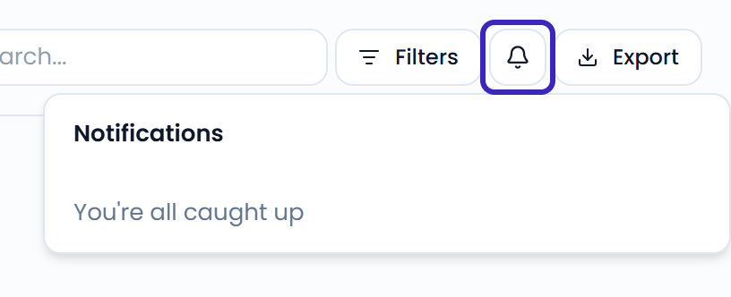
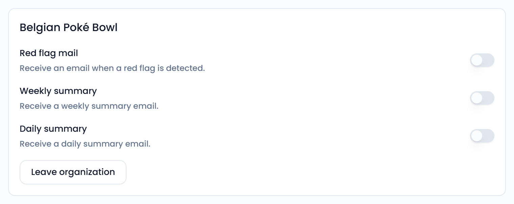

Feedelity notifies you when something needs your attention. You see notifications in the app and get them by email.

## In the app

Click the bell icon to open **Notifications**. A red badge shows how many new notifications you have. Click a notification to go straight to the case, or to **Settings** > **Users** for a join request.

Your unread notifications also appear under **Unread notifications** on the **Home** page.

{/* SCREENSHOT: /home — the bell icon with a badge and the Notifications popover open */}
<Frame>
  
</Frame>

## What you're notified about

| Notification | When you get it |
| --- | --- |
| A review was flagged urgent | A case at one of your locations gets a [red flag](/settings/flags). |
| A case was assigned to you | A teammate assigns a case to you. |
| *Name* mentioned you in a comment | A teammate mentions you with `@` in a case comment. |
| *Name* left a new comment | A teammate comments on a case you commented on or that's assigned to you. |
| *Name* asks to join *organization* | Someone asks to join your organization. Only administrators get this. |

You don't get notified about your own actions. See [Assigning and comments](/inbox/assigning-and-comments) for how mentions work.

## Email

Every notification is also sent to you by email. Only red flag emails can be turned off.

You choose your emails per organization on your profile:

1. Click your name at the bottom of the sidebar, then click **Account**.
2. Under **My organizations**, find the organization.
3. Turn each email on or off:
   - **Red flag mail**: an email when a red flag is detected.
   - **Daily summary**: a summary email every morning.
   - **Weekly summary**: a summary email every Monday morning.

{/* SCREENSHOT: /profile — an organization card under My organizations with the three email toggles */}
<Frame>
  
</Frame>

Summary emails are sent at 06:00 UTC. Organizations without an active license don't send summaries.

## Mobile push notifications

If you use the Feedelity mobile app, you also get each notification as a push notification on your phone. Turning off **Red flag mail** also stops red flag push notifications.

{/* TODO: confirm the Feedelity mobile app is available to customers, its name, and where to download it */}
