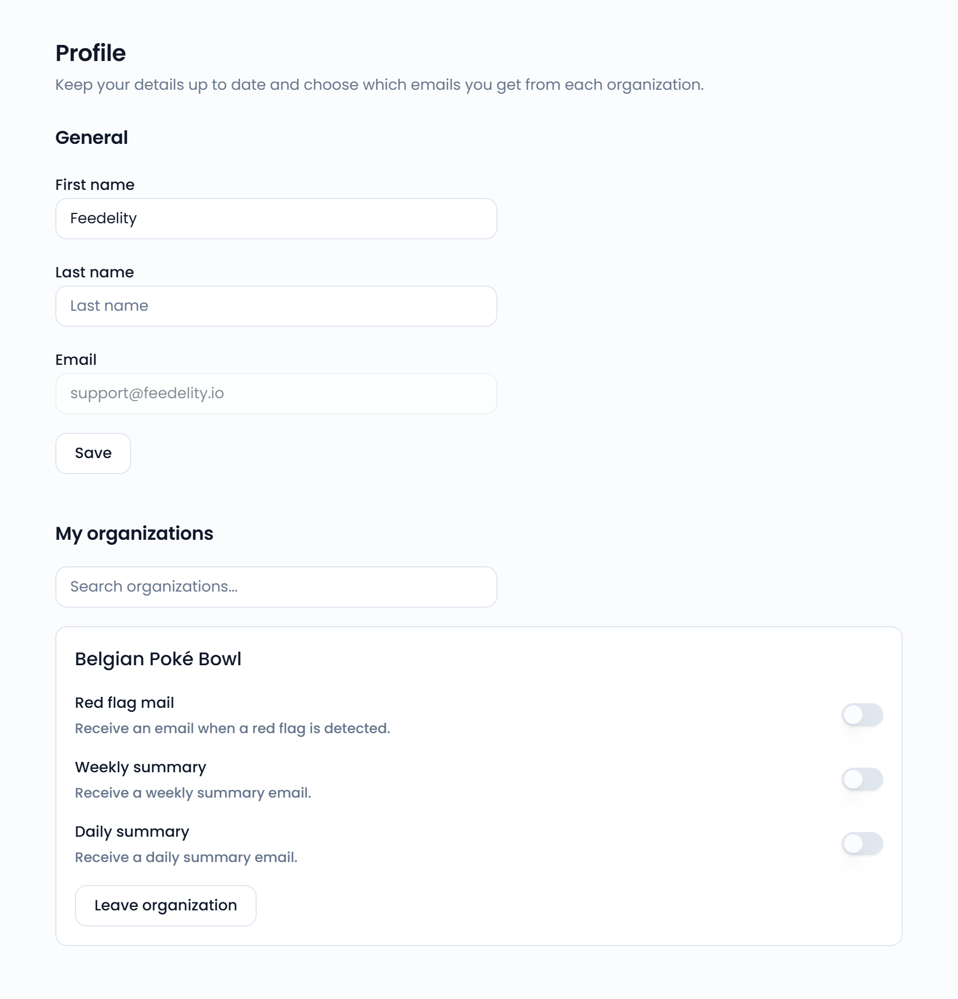
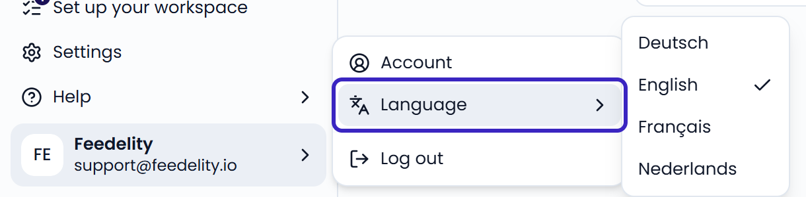

Your profile holds your personal details and the organizations you belong to. To open it, click your name at the bottom of the sidebar, then click **Account**.

{/* SCREENSHOT: /profile — the Profile page with the General and My organizations sections */}
<Frame>
  
</Frame>

## Change your name

1. Under **General**, edit **First name** and **Last name**.
2. Click **Save**.

You can't change your **Email** here.

## Change your language

1. Click your name at the bottom of the sidebar.
2. Hover over **Language**.
3. Pick a language: English, Nederlands, Français, or Deutsch.

The app reloads in the new language. The checkmark shows your current language.

{/* SCREENSHOT: /home — the user menu open with the Language submenu */}
<Frame>
  
</Frame>

## Change your password

You change your password from the login page.

1. Click your name at the bottom of the sidebar, then click **Log out**.
2. On the login page, click **Forgot password?**.
3. Enter your email address. Feedelity emails you a code.
4. Enter the code, then choose a new password of at least 12 characters.

If you log in with **Continue with Microsoft**, your Microsoft account manages your password. See [Log in and reset your password](/getting-started/log-in).

## Your organizations

**My organizations** lists every organization you belong to. Use the search box to find one. To learn how organizations and roles work, see [How users and organizations work](/getting-started/users-and-organizations).

For each organization, you choose which emails you get. See [Notifications](/profile/notifications).

### Leave an organization

1. Find the organization under **My organizations**.
2. Click **Leave organization**.
3. Click **Leave** to confirm.

You lose access to all of that organization's data. To get back in, ask an administrator to invite you again.

<Warning>
  If you're the only administrator, make another user an administrator first under **Settings** > **Users**. Otherwise nobody can manage the organization's settings or users.
</Warning>
