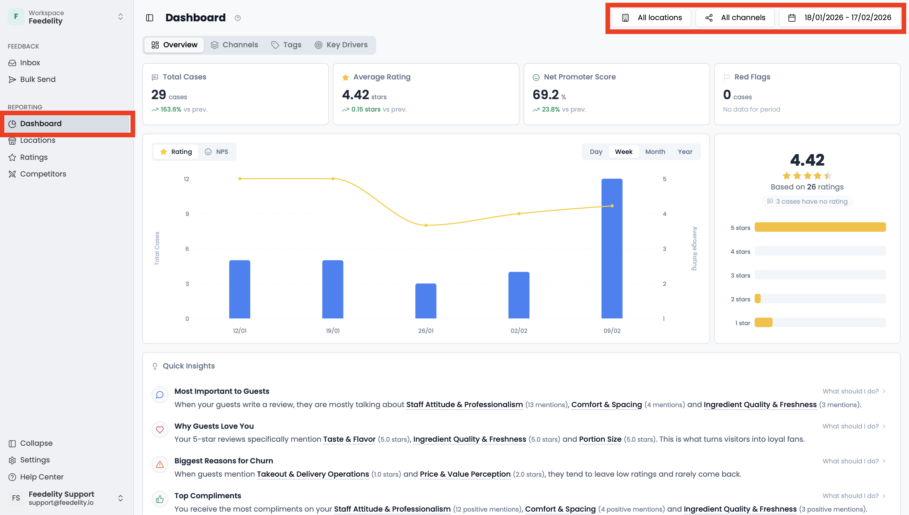
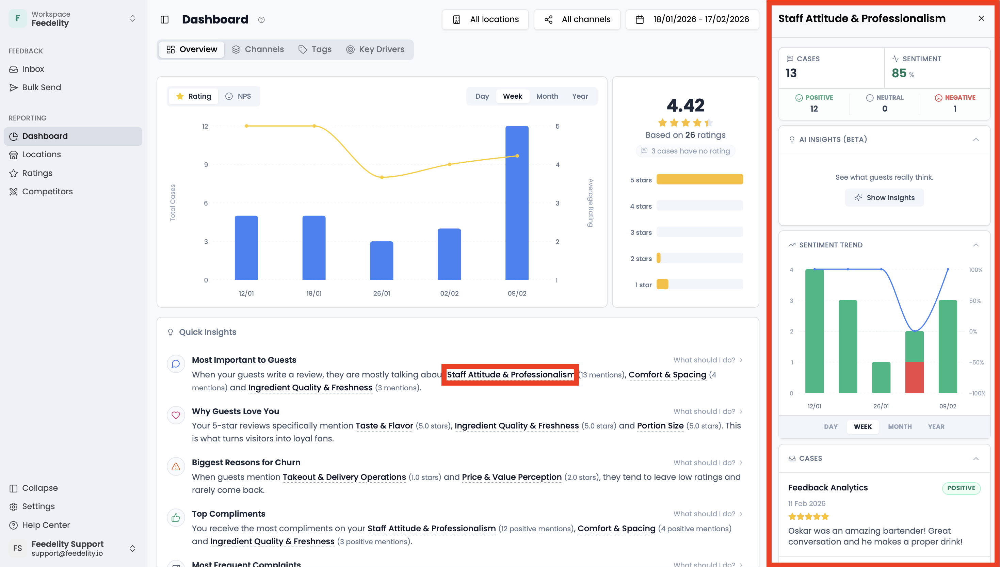
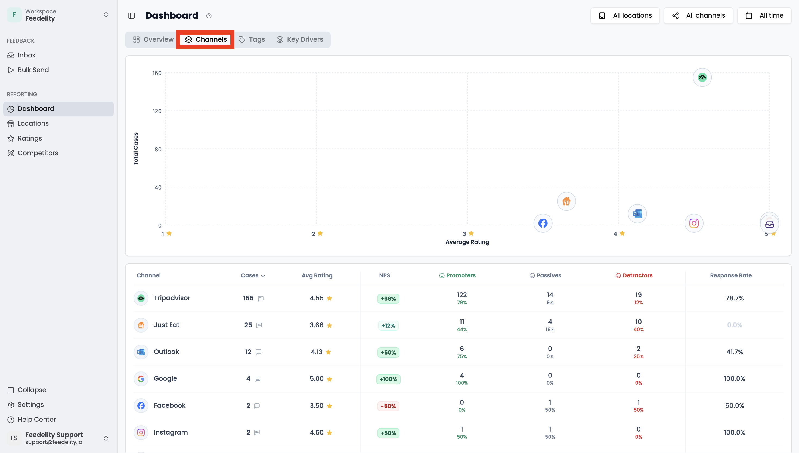
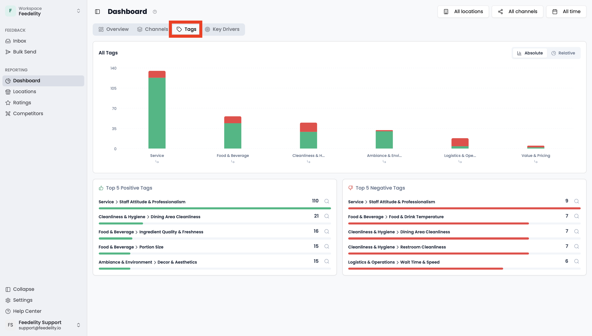
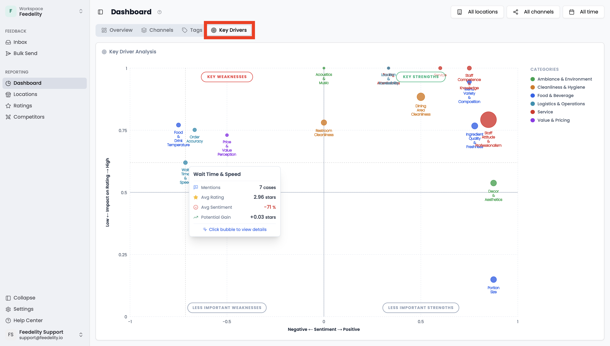

The **Dashboard** gives you a clear visual summary of your business's performance. Use it to track progress and key metrics over time. Refine the data with the filters at the top: locations, channels, and period.

The dashboard has four tabs.

## Overview

The **Overview** tab shows your most important metrics, such as total cases, average rating, and NPS. It also shows how volume and ratings evolve over time, plus **Quick Insights** into what your guests are saying.

Click a topic to open a side panel with more detail. There you can:

- Generate an AI summary of what people say about the topic
- See the topic's sentiment over time
- See the specific cases

## Channels

The **Channels** tab shows which channels your guests use to leave feedback, with the volume, NPS, and response rate for each.

## Tags

The **Tags** tab shows the topics mentioned in guest feedback, each with its sentiment.

Click a tag to see its lower-level tags. If you click a tag that's already at the lowest level, a sidebar opens with more details about it.

## Key drivers

The **Key Drivers** tab shows your organization's strengths and weaknesses at a glance. Each tag is plotted by its average sentiment and its impact on the rating. Impact is the Pearson correlation between the tag's sentiment and the review rating.

Hover over a tag to see more details, including the **potential gain**. This shows how much higher your average rating would be if all reviews with negative mentions of that tag were removed. Click a tag to open a sidebar with more details.

