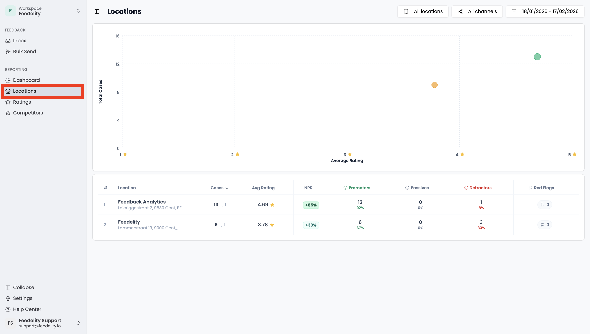

The **Locations** page lets you compare the performance of your organization's locations. Compare basic statistics such as volume, rating, NPS, and red flags. You can filter by location, channel, and period.

Click a location to open the dashboard with that location's filter already applied.

