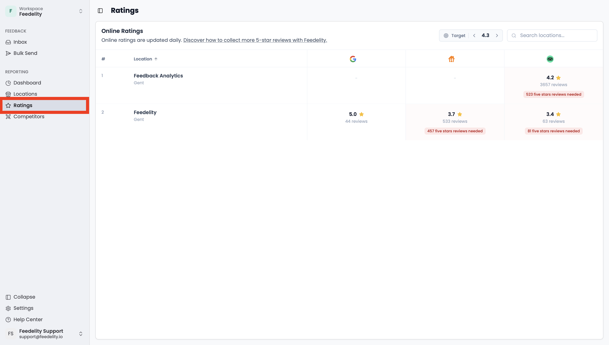

The **Ratings** page gives you an overview of the public scores on connected platforms for every location. These are the scores customers see online.

You can set a target rating for your organization and see how many 5-star reviews each location still needs to reach it. This makes the goal tangible and motivates teams by showing exactly how much positive feedback they need.

## What you see on this page

For each location, the page shows:

- The current online rating
- The total number of reviews
- The number of additional 5-star reviews needed to reach the target

The ratings come directly from the connected platforms, such as Google. Feedelity doesn't calculate them. Data syncs once a day, so new reviews appear within 24 hours.

Platforms like Google round their ratings to one decimal. So the score on this page only changes once the underlying average crosses the next rounding threshold. New 5-star reviews always push the average up, even when the displayed score hasn't moved yet.

## Set a target rating

Admins can set a target rating for the whole organization. Feedelity uses this target to calculate how many extra 5-star reviews each location needs.

<Tip>
  Pick a realistic target slightly above your current average, for example from 4.3 to 4.5. Targets very close to 5 need a disproportionate number of new reviews and can feel demotivating for teams.
</Tip>

## How the calculation works

The number of 5-star reviews needed is based on three values: the current number of reviews (n), the current average rating (r), and the target rating. The formula is:

**x = n × (target − r) / (5 − target)**

The more reviews a location already has, the more new 5-star reviews it needs to move the average. A review of 4 stars or lower increases the number, because it pulls the average down when the target is above 4.

## Track progress over time

The **Ratings** page shows the rounded public score, which can take time to move. To see actual day-to-day progress, use the main dashboard and filter by location and by Google. There you can see exactly how many 5-star reviews you collected in a given month, even when the public score hasn't ticked up yet.

## Communicate this to your teams

Every 5-star review counts toward the average, even when the displayed score doesn't change right away. Progress builds up in the background and shows the moment the average crosses the next rounding threshold.

Encourage teams to keep going. Use the monthly review counts in the main dashboard to celebrate short-term wins.
