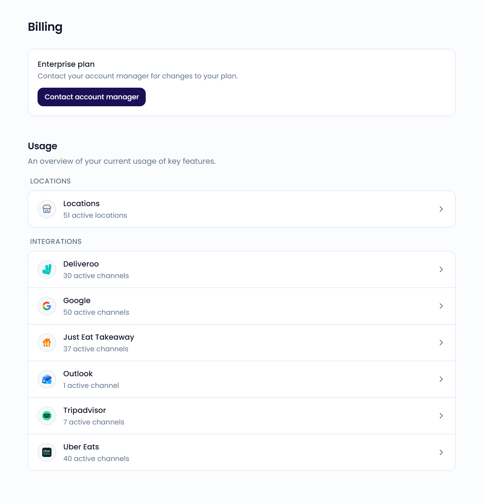

On the **Billing** page, you see your plan, your usage, and your subscription. Go to **Settings** > **Billing**, in the **Organization** section, to open it.

<Note>
  Only administrators can access **Settings**.
</Note>

{/* SCREENSHOT: /settings/billing — the plan row and the Usage section */}
<Frame>
  
</Frame>

## Your plan

What you see at the top of the page depends on your plan.

### Trial

A banner shows the date your free trial ends. Below it, you see the available plans:

- To keep using Feedelity after the trial, click **Choose Standard** and complete the checkout.
- For the **Enterprise plan**, click **Contact sales**.

When your trial ends without a plan, the banner says "No active license. Choose a plan to continue using Feedelity."

{/* TODO: confirm current Standard and Enterprise plan contents and pricing before documenting them */}

### Standard plan

Your subscription is billed monthly, based on your active locations and integrations. It's managed through Stripe.

- Click **Manage subscription** to update your payment method, view your invoices, or change your plan.
- If your last payment didn't go through, or your subscription is paused, a red banner appears. Click **Update payment details** to fix it.
- If your subscription has ended, choose a plan again to continue using Feedelity.

Your subscription renews automatically each month. If you make changes mid-cycle, your invoice is prorated, so you only pay for what you use.

### Enterprise plan

The **Enterprise plan** row shows the date your license runs until. For changes to your plan or questions about invoices, click **Contact account manager**.

## Features per plan

Some features are included in the trial and the Standard plan, and are add-ons on the Enterprise plan:

- Loyalty: [games](/loyalty/games), [offers](/loyalty/offers), and [vouchers](/loyalty/vouchers)
- [QR codes](/collecting-feedback/qr-codes) and [forms](/collecting-feedback/forms)
- [Bulk send](/inbox/bulk-actions)
- [Competitors](/analytics/competitors)
- Delivery platform credit in [replies](/inbox/credit)

A feature your plan doesn't include is grayed out, with a lock and an **Add-on** label. Hover over it to learn what it does. To add it, contact your account manager.

{/* TODO: confirm with sales how Enterprise customers buy add-ons, and whether this list should be public */}

## Usage

The **Usage** section shows:

- **Locations**: the number of active locations. Click it to open [Locations](/settings/locations).
- **Integrations**: the number of active channels per integration. Click one to open [Integrations](/integrations/manage).

## When your license is inactive

When your license is no longer active, your team loses access to the inbox and analytics. Administrators are sent to the **Billing** page to renew it. Members and viewers see a **License inactive** page and need to ask an administrator. See [License inactive](/faq/license-inactive).
