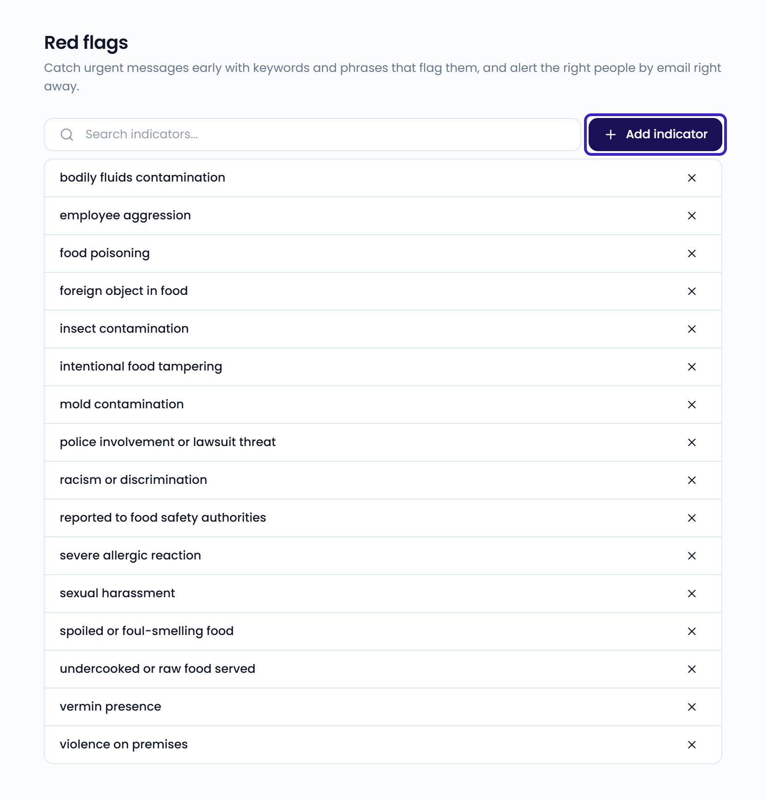

Red flags catch urgent feedback early, so your team can respond to critical situations right away.

You add indicators: keywords or phrases that mark feedback as urgent, such as "food poisoning" or "lawsuit". Feedelity's AI checks each new message against your indicators. It also picks up feedback with the same meaning in other words or languages.

## What happens when feedback is flagged

- The case gets a red flag in the [inbox](/inbox/overview). You can filter the inbox on flagged cases.
- Users with access to the case's location get a notification.
- Users who turned on **Red flag alerts** also get an email right away.

Each user chooses whether they get red flag emails. Admins set this under [Users](/settings/users#manage-a-user), and users can change it in their [profile](/profile/notifications).

## Manage indicators

Go to **Settings** > **Red flags**, in the **Analytics** section.

<Note>
  Only administrators can access **Settings**.
</Note>

{/* SCREENSHOT: /settings/flags — the list of indicators with the Add indicator button */}
<Frame>
  
</Frame>

- To add an indicator, click **Add indicator**, enter a keyword or phrase, and click **Create**.
- To remove an indicator, click the **X** icon next to it.
- To find an indicator, use the search box.
