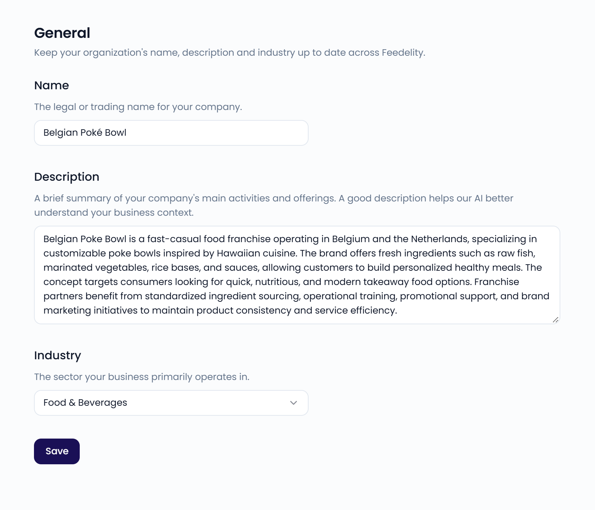

On the **General** page, you keep your organization's name, description, and industry up to date. Go to **Settings** > **General**, in the **Organization** section, to open it.

<Note>
  Only administrators can access **Settings**.
</Note>

{/* SCREENSHOT: /settings/general — the General page with Name, Description, and Industry */}
<Frame>
  
</Frame>

## Organization details

- **Name**: the legal or trading name of your company.
- **Description**: a brief summary of what your company does and offers. A good description helps the AI understand your business context.
- **Industry**: the sector you mainly operate in: **Food & Beverages**, **Hotels & Accommodation**, or **Retail & Consumer Goods**.

Click **Save** to apply your changes.

For example, a good description reads: "Mario's Pizza is a fast-casual pizza chain serving families and young professionals across 30+ Belgian locations. Known for wood-fired pizzas and fresh local ingredients, we offer dine-in, takeaway, and delivery."
