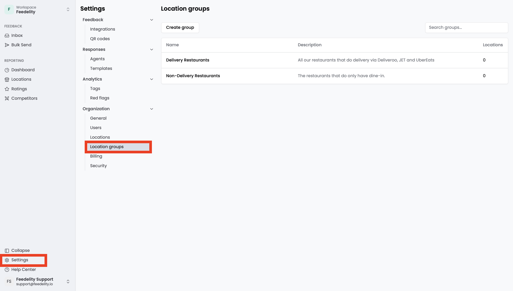
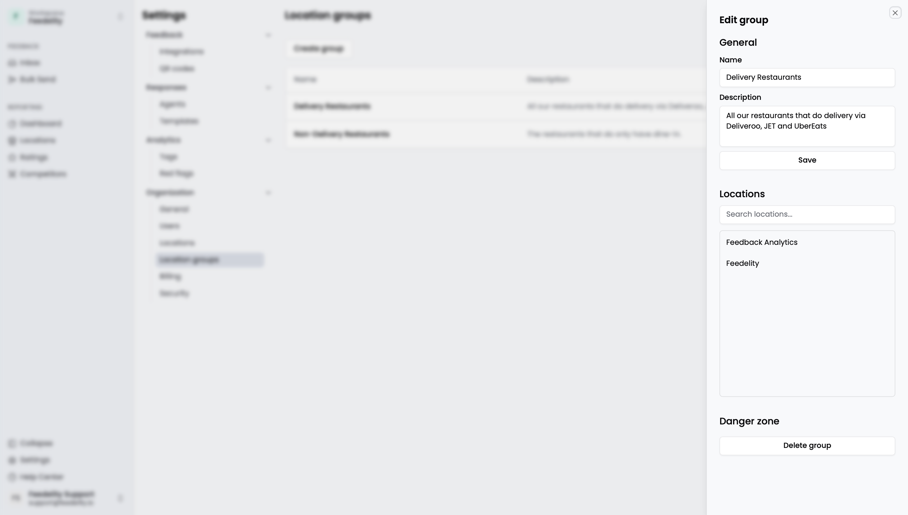

Feedelity centralizes feedback from all your [locations](/settings/locations). As your business grows, analyzing performance across dozens or hundreds of locations gets complex.

Location groups let you **bundle locations based on criteria that matter to your business**, such as geographic region, manager, or store type. A location can belong to multiple groups. For example, a store can belong to both a "North Region" group and a "Delivery Restaurants" group.

Use location groups to filter your dashboards and the inbox to the relevant part of your business.

## Manage location groups

To create a location group, click **Add group**. Enter a name and a description. You can update both at any time.

Click a group to open a side panel, where you manage which locations belong to the group.

To delete a group, click **Delete group**.

<Note>
  Deleting a group doesn't delete the locations in it.
</Note>

