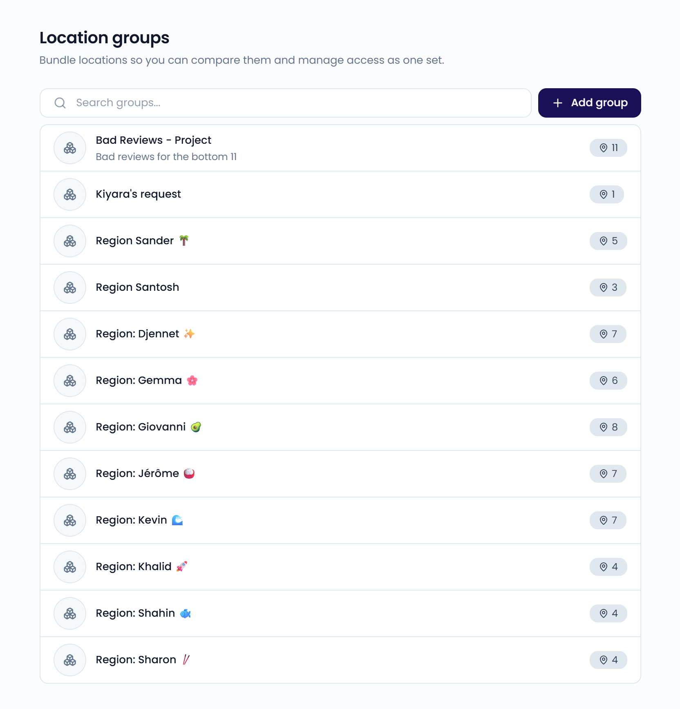
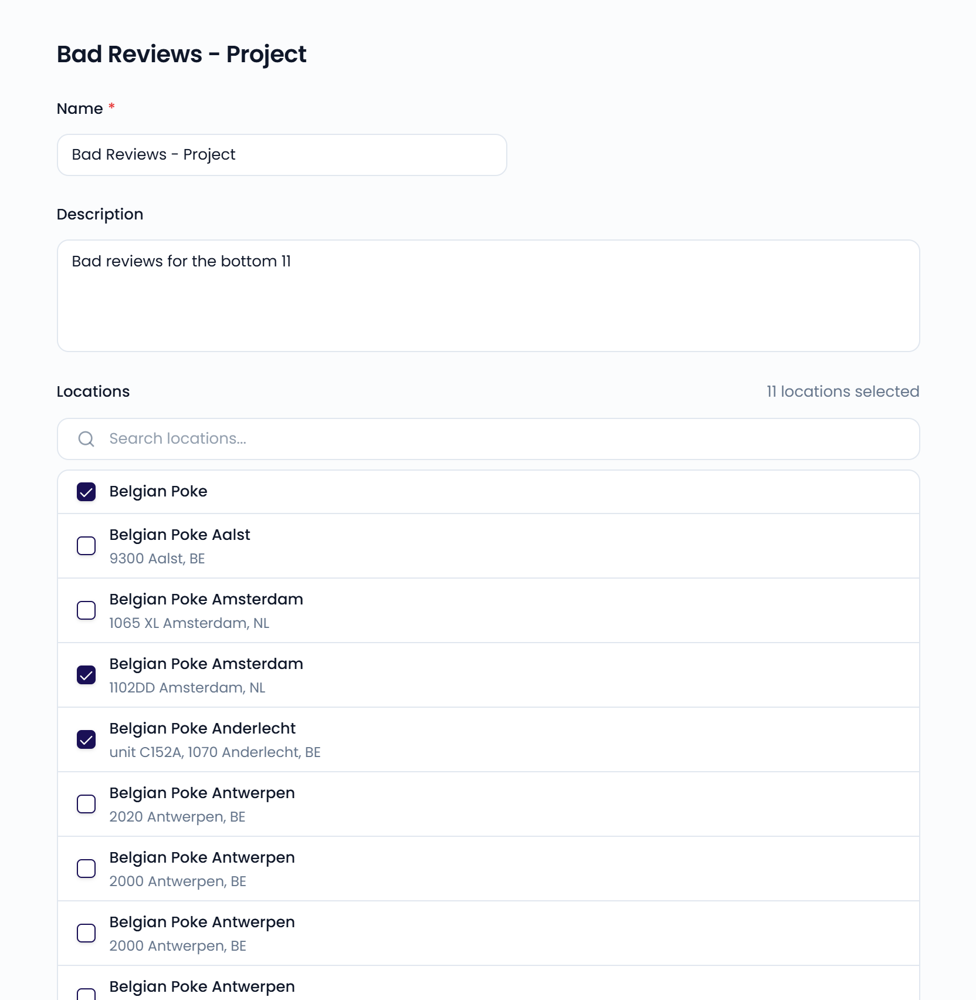

As your business grows, analyzing dozens or hundreds of [locations](/settings/locations) one by one gets complex. Location groups let you bundle locations based on what matters to your business, such as region, manager, or restaurant type.

A location can belong to several groups. For example, a restaurant can belong to both a "North Region" group and a "Delivery Restaurants" group.

Use location groups to:

- Filter your dashboards and the inbox to part of your business
- Give a user access to all locations in a group at once. See [Users](/settings/users#location-access).

Go to **Settings** > **Location groups**, in the **Organization** section, to manage them.

{/* SCREENSHOT: /settings/location-groups — the list of location groups */}
<Frame>
  
</Frame>

## Create a location group

<Steps>
  <Step title="Start a new group">
    Click **Add group**.
  </Step>
  <Step title="Name the group">
    Enter a **Name** and, optionally, a **Description**.
  </Step>
  <Step title="Choose the locations">
    Under **Locations**, select the locations that belong to the group.
  </Step>
  <Step title="Save">
    Click **Save**.
  </Step>
</Steps>

## Edit a location group

Click a group to change its name, description, or locations. Click **Save** to apply your changes.

You can also add a single location to a group from the location's own page. See [Locations](/settings/locations#add-the-location-to-a-group).

{/* SCREENSHOT: /settings/location-groups/<id> — the group page with Name, Description, and the Locations list */}
<Frame>
  
</Frame>

## Delete a location group

Open the group, click **⋯**, and choose **Delete group**. Confirm with **Delete group**.

<Note>
  Deleting a group doesn't delete the locations in it.
</Note>
