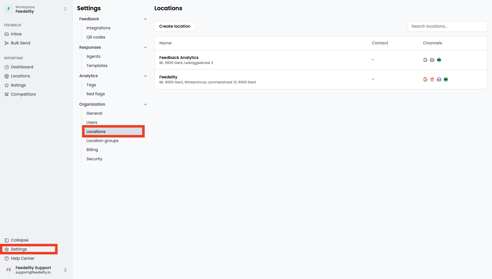
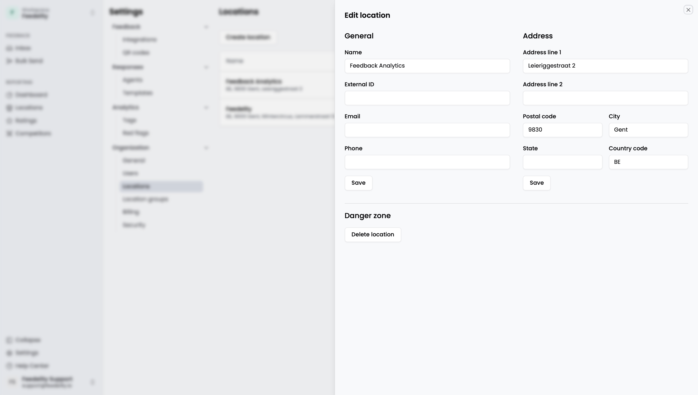

A location represents a distinct business unit, such as a physical store or office.

The **Locations** page is your central hub to create, view, and manage all your locations. Here, you organize your location data and see which channels are linked to each location. Go to **Settings** > **Locations** to open it.

<Note>
  Only admins can access this page.
</Note>

## Location details

Click a location to manage its general information, such as name, contact details, and address.

## Manage locations

- To create a location, click **Add location**.
- To delete a location, click **Delete location**.
- You can update location information at any time.

When you link a new location from Google, Feedelity creates a location automatically.
