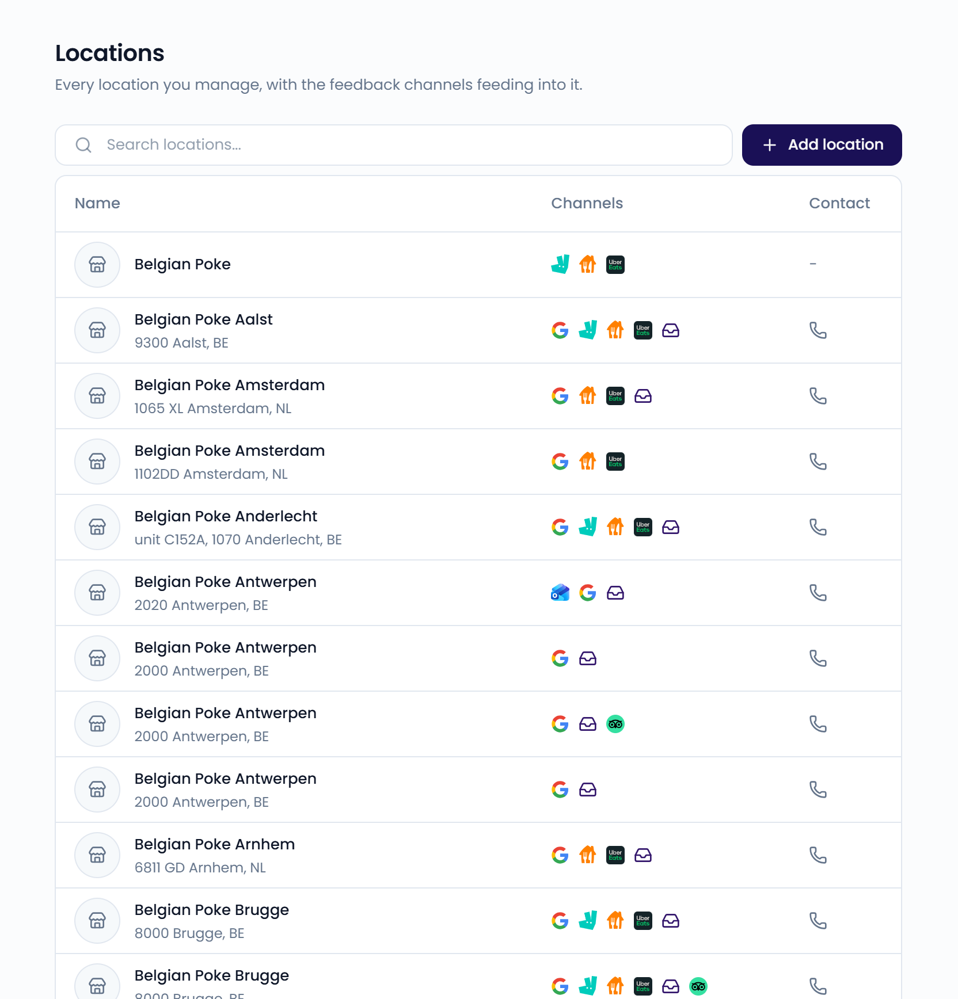
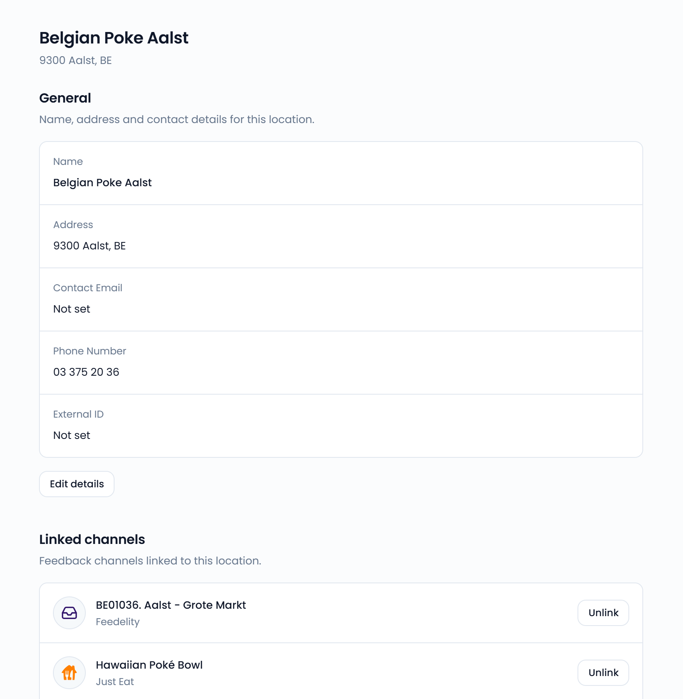

A location is a single restaurant. Locations connect your feedback channels and power your dashboards and benchmarks.

The **Locations** page lists every location you manage, with the channels linked to it. Go to **Settings** > **Locations**, in the **Organization** section, to open it.

<Note>
  Only administrators can access **Settings**.
</Note>

{/* SCREENSHOT: /settings/locations — the locations table with Name, Channels, and Contact columns */}
<Frame>
  
</Frame>

## Add a location

<Steps>
  <Step title="Open the form">
    Click **Add location**.
  </Step>
  <Step title="Enter the details">
    Enter the name, and optionally the address and contact details.
  </Step>
  <Step title="Create the location">
    Click **Create location**.
  </Step>
</Steps>

When you connect your first channels and your organization has no locations yet, Feedelity creates the locations for you. See [How integrations work](/integrations/how-integrations-work).

## Location details

Click a location to open it. The location page has three sections:

- **General**: the **Name**, **Address**, **Contact Email**, **Phone Number**, and **External ID**. Click **Edit details** to change them.
- **Linked channels**: the feedback channels linked to this location.
- **Location groups**: the [location groups](/settings/location-groups) this location belongs to.

Use **External ID** for an identifier from your own system, so you can match the location to your records.

{/* SCREENSHOT: /settings/locations/<id> — location page with General, Linked channels, and Location groups */}
<Frame>
  
</Frame>

### Link or unlink a channel

- To link a channel, click **Link a channel**. This takes you to [Integrations](/integrations/manage).
- To unlink a channel, click **Unlink** next to it and confirm with **Unlink channel**. You can link it again from **Integrations**.

### Add the location to a group

Click **Add to location group** and choose a group. To take the location out of a group, click **Remove** next to the group. The group and the location both stay.

## Delete a location

<Steps>
  <Step title="Open the menu">
    Open the location and click **⋯** in the top-right corner.
  </Step>
  <Step title="Delete">
    Choose **Delete location** and confirm with **Delete Location**.
  </Step>
</Steps>

<Warning>
  Deleting a location also unlinks its channels. This can't be undone.
</Warning>
