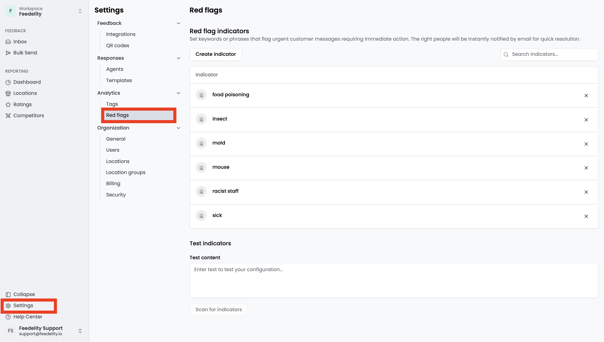
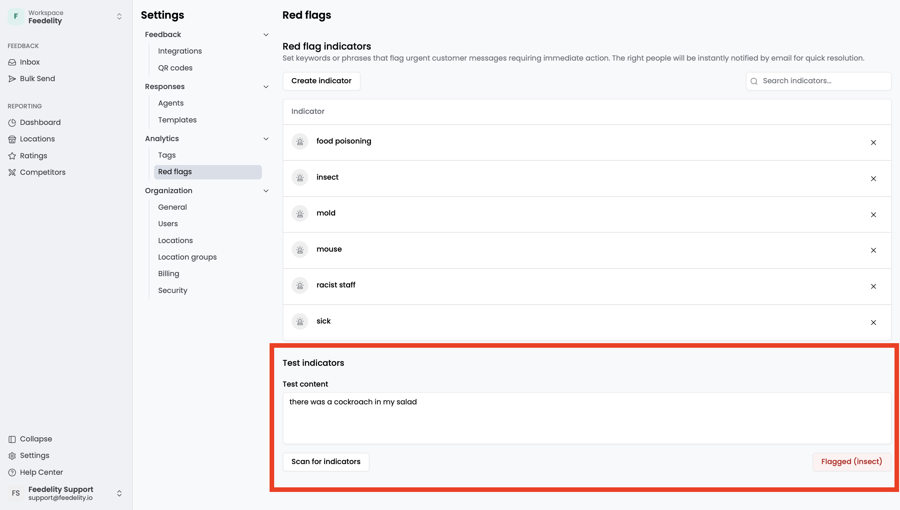

Red flags automatically detect urgent customer feedback and notify the right people. They help you spot high-priority feedback fast, so your team can respond to critical situations promptly.

You create red flag indicators: keywords or phrases that automatically flag urgent customer feedback. Feedelity picks up any feedback related to those keywords or phrases, in any language.

Admins manage red flags under **Settings** > **Red flags**.

## Manage red flags

To create a red flag indicator, click **Add indicator**. To remove an indicator, click the **X** icon on its right.

## Test your alerts

<Steps>
  <Step title="Enter example feedback">
    Enter example customer feedback in the text box.
  </Step>
  <Step title="Scan for indicators">
    Click **Scan for indicators**.
  </Step>
  <Step title="Review the result">
    Feedelity shows whether the example feedback triggers any of your indicators.
  </Step>
</Steps>

