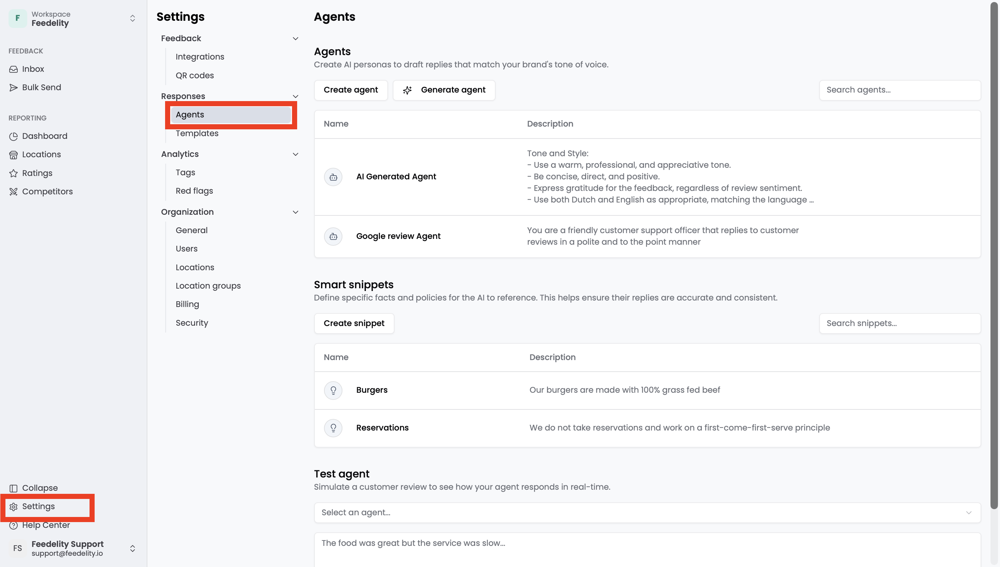
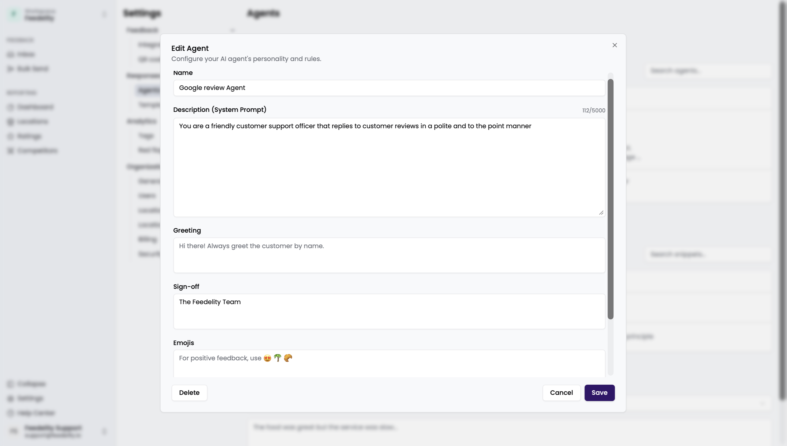
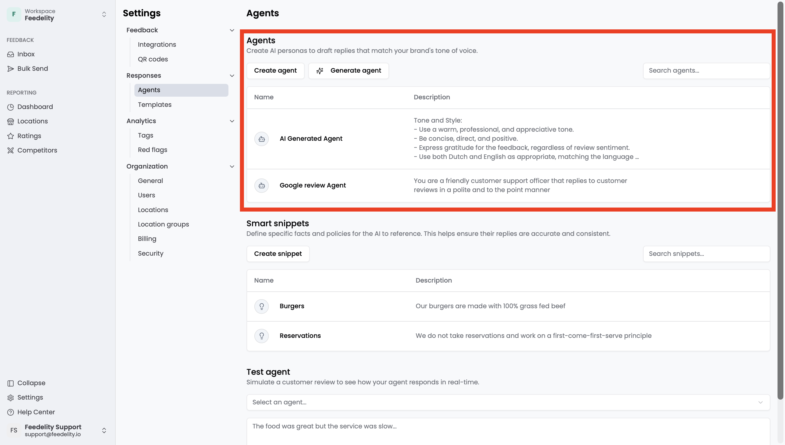
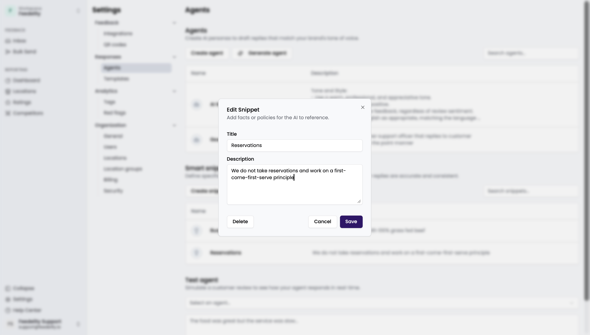
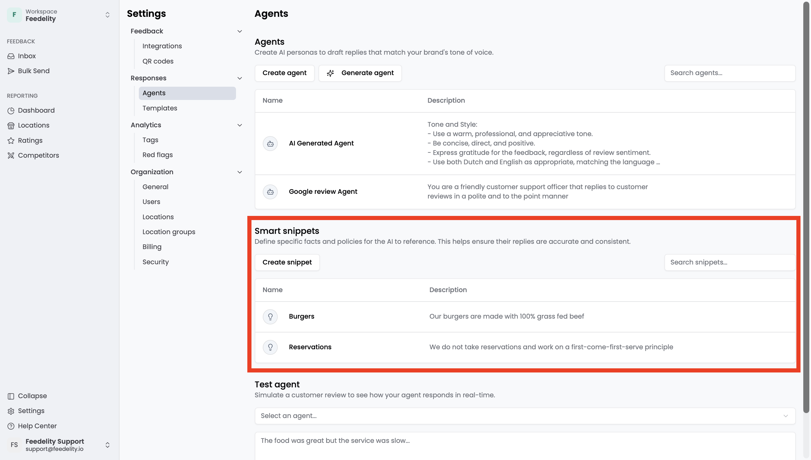
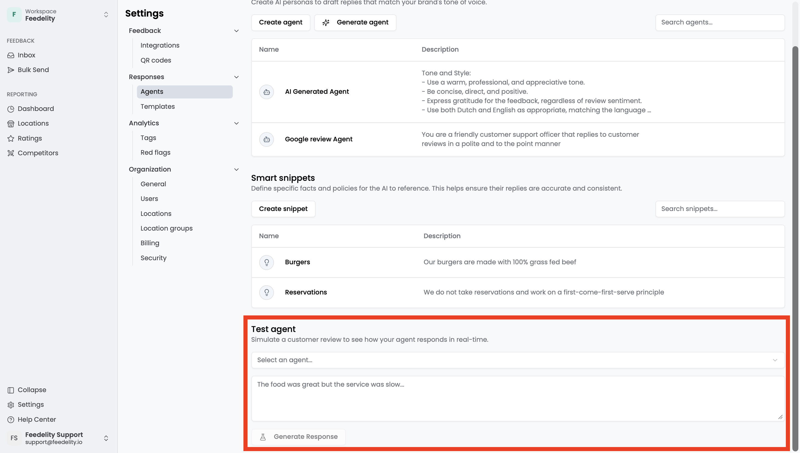

AI reply agents let you reply to customer feedback in a customized and efficient way. Create an agent to answer your guests in your brand's tone of voice. Go to **Settings** > **Agents** to open the page.

## Agent settings

You can configure each AI reply agent with these settings:

- **Agent Name**: The name you select when you use the agent to generate a reply.
- **Instructions**: Guidelines for how the agent replies, such as the tone (formal, friendly) and how concise the answers are.
- **Greeting**: Instructions for how the reply opens.
- **Sign-off**: Instructions for how the reply closes.
- **Emojis**: The emojis you want the agent to use.
- **Contact Info**: Information that encourages customers to stay in touch, such as your website, phone number, or email address.

To create an agent, click **Add agent**. A pop-up opens where you configure the agent's instructions. To update an existing agent, click it.

## Generate an agent

Choose **Generate from my replies** to let AI create an agent in your brand's tone of voice. It looks at your historical Google reviews and how you replied to them.

<Note>
  This only works if you've connected your Google account to Feedelity and have enough historical review-reply pairs.
</Note>

## Smart snippets

Smart snippets are pieces of company-specific knowledge that your AI reply agents use when they reply to feedback and questions. The AI only includes a smart snippet in a reply when it's relevant to the customer's feedback. Smart snippets keep your agents' replies factual, consistent, and tailored to your business.

For example, your company doesn't take reservations, and a customer complains they couldn't book a table. A smart snippet provides the correct information, and the reply might say: *"We don't take reservations, we operate on a first-come, first-served basis."*

To create a smart snippet, click **Add smart snippet**. A pop-up opens where you write the snippet's description. To edit or delete an existing snippet, click it.

## Test agents and smart snippets

You can test your AI reply agents and smart snippets. Select an agent, enter a test customer feedback message, and click **Generate response**.

