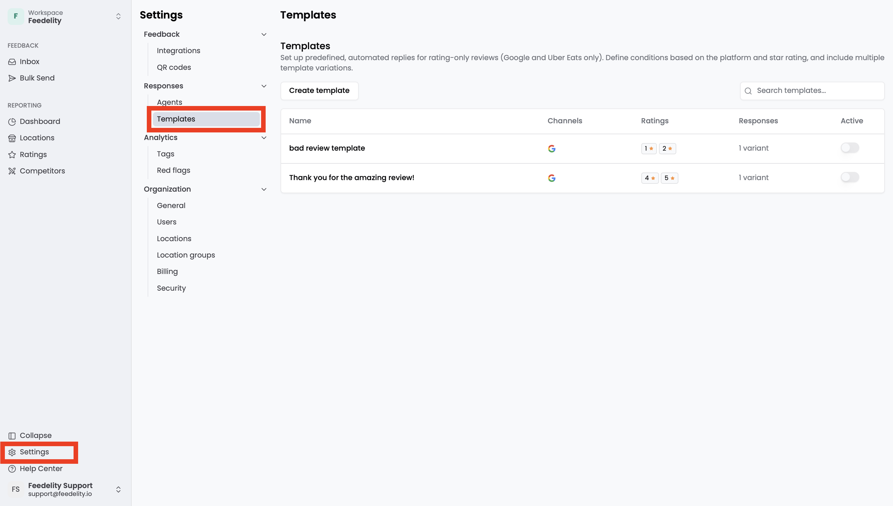
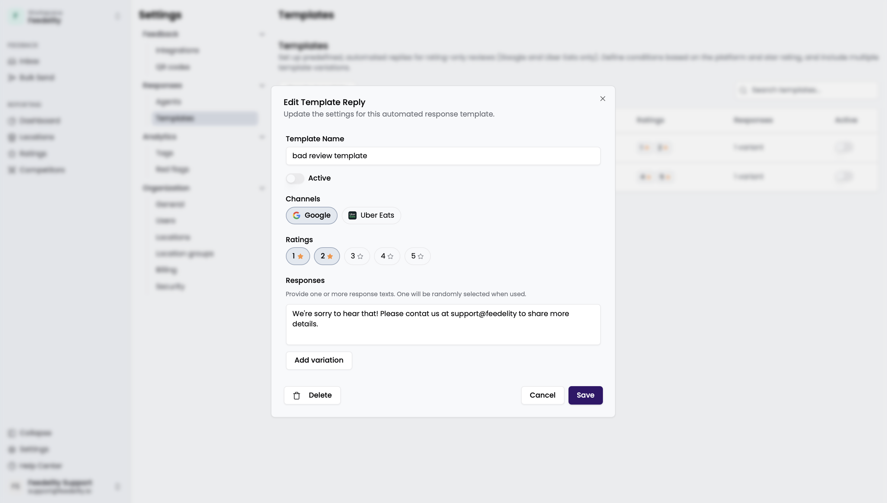
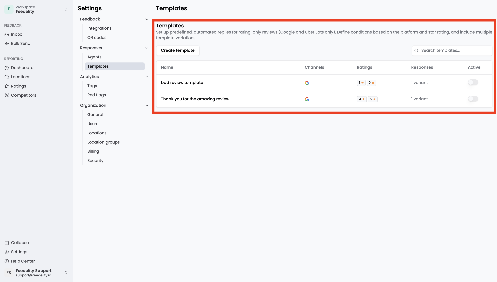

**Response templates** are pre-written responses that reply automatically to reviews without text (star rating only). Templates trigger based on the conditions you configure.

Response templates handle customer feedback efficiently and consistently, so you don't waste valuable time and resources. Go to **Settings** > **Templates** to open the page.

## Template settings

You can configure each template with these settings:

- **Name**: A descriptive name for the template.
- **Channels**: The channels where the template is active, such as Google reviews or Uber Eats.
- **Ratings**: The star ratings that trigger the template.
- **Responses**: The replies the system uses. You can add multiple variations. The system picks one at random for each triggered response, for variety.

## Manage templates

- To add a template, click **Create template**.
- To modify a template, click it. In the pop-up, you can edit, save, or delete the template.
- To activate or deactivate a template, use the toggle on the right.

