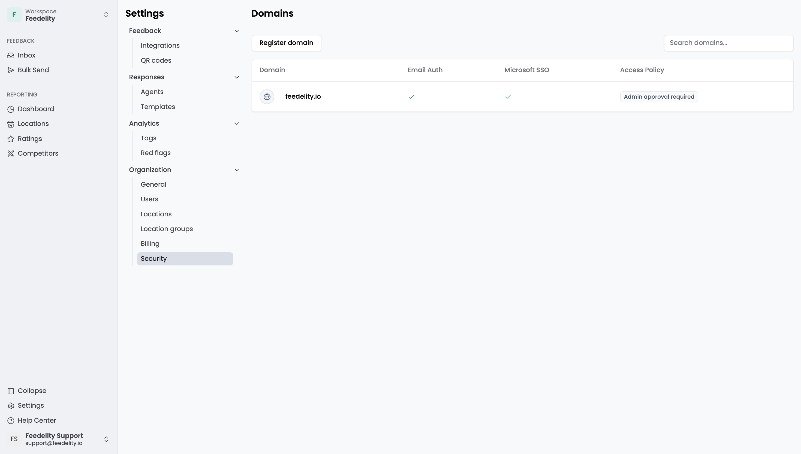
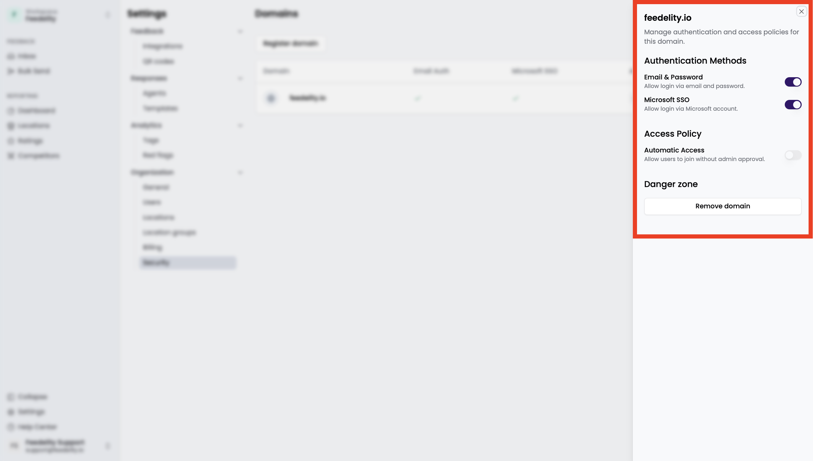

On the **Security** page, you manage your organization's verified email domains. Once you verify a domain, such as `feedelity.io`, you control how users with matching email addresses sign in to Feedelity. Go to **Settings** > **Security** to open it.

<Note>
  Only admins can see this page.
</Note>

## Domain settings

Each domain has:

- A domain name
- Allowed authentication methods:
  - **Email & Password**: users log in with their email and password.
  - **Microsoft SSO**: users log in with their Microsoft account.
- An **Access Policy**, which lets users join without admin approval

## Manage domains

### Add a domain

<Steps>
  <Step title="Register the domain">
    Click **Register domain**.
  </Step>
  <Step title="Enter the domain name">
    Enter the domain name, for example `company.com`.
  </Step>
  <Step title="Enter an email address">
    Enter a valid email address from that domain.
  </Step>
  <Step title="Verify the domain">
    Enter the verification code you receive by email.
  </Step>
</Steps>

### Update domain settings

<Steps>
  <Step title="Open the domain">
    Click the domain you want to edit.
  </Step>
  <Step title="Update authentication methods">
    Update the allowed authentication methods. Changes save automatically.
  </Step>
</Steps>

### Delete a domain

<Steps>
  <Step title="Remove the domain">
    Click **Remove domain**.
  </Step>
  <Step title="Confirm">
    Confirm in the pop-up to complete the deletion.
  </Step>
</Steps>
