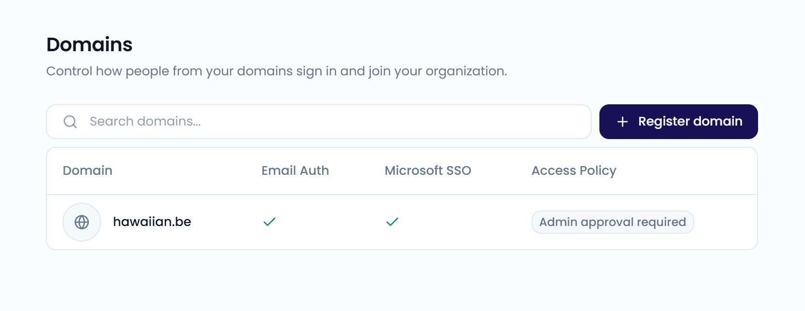
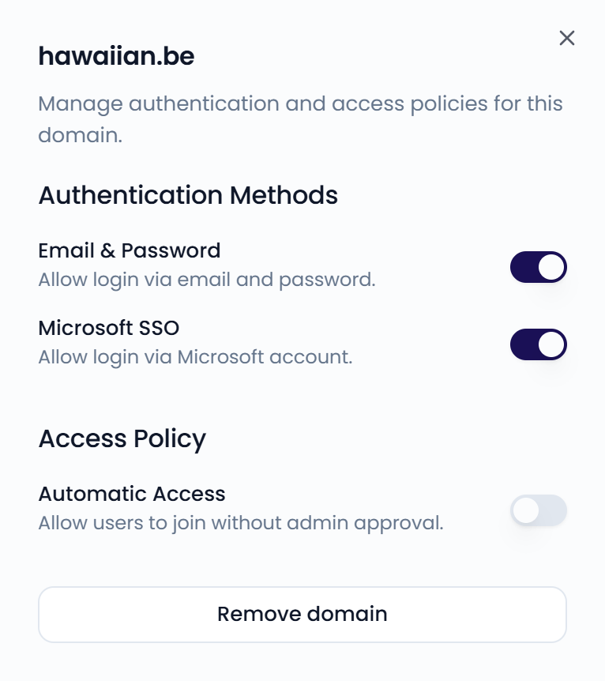

On the **Security** page, you register your company's email domains. Once you verify a domain, such as `yourcompany.com`, you control how people with that email domain sign in and join your organization. Go to **Settings** > **Security**, in the **Organization** section, to open it.

<Note>
  Only administrators can access **Settings**.
</Note>

{/* SCREENSHOT: /settings/security — the Domains table with Domain, Email Auth, Microsoft SSO, and Access Policy columns */}
<Frame>
  
</Frame>

## Register a domain

<Steps>
  <Step title="Start the wizard">
    Click **Register domain**, then **Get started**.
  </Step>
  <Step title="Enter the domain">
    Enter the domain name, for example `yourcompany.com`. Click **Check Availability**.
  </Step>
  <Step title="Choose an email address">
    Under **Email Prefix**, enter the part before the `@`, for example `info`. Click **Send Verification Code**.
  </Step>
  <Step title="Verify the domain">
    Enter the 6-digit code you received by email and click **Verify Domain**. Then click **Finish**.
  </Step>
</Steps>

## Domain settings

Click a domain to open its settings. Changes save automatically.

Under **Authentication Methods**, choose how users with this email domain sign in:

- **Email & Password**: sign in with an email address and password.
- **Microsoft SSO**: sign in with a Microsoft account.

Under **Access Policy**, turn on **Automatic Access** to let people with this email domain join your organization without admin approval. When it's off, they send a join request that an admin approves or rejects under [Users](/settings/users#join-requests).

{/* SCREENSHOT: /settings/security — the domain side panel with Authentication Methods and Access Policy */}
<Frame>
  
</Frame>

## Remove a domain

Click the domain and click **Remove domain**. The domain is removed right away, without a confirmation step.
