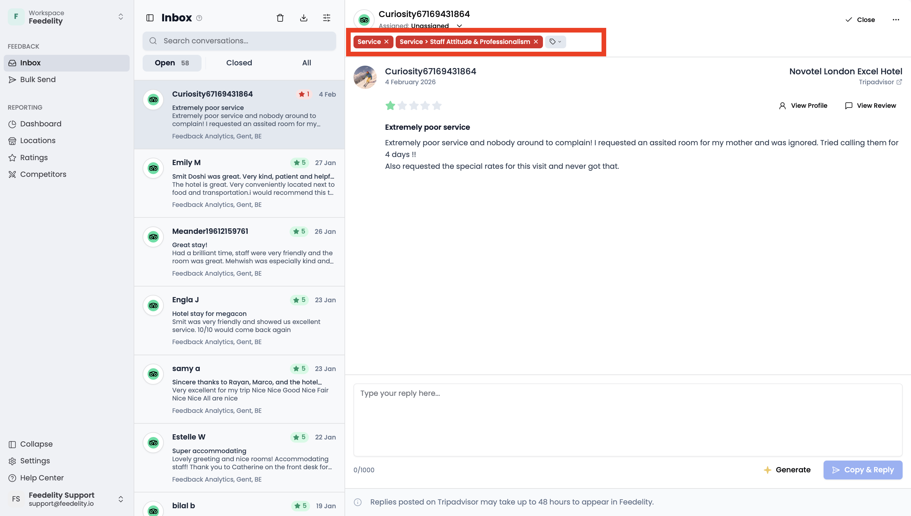
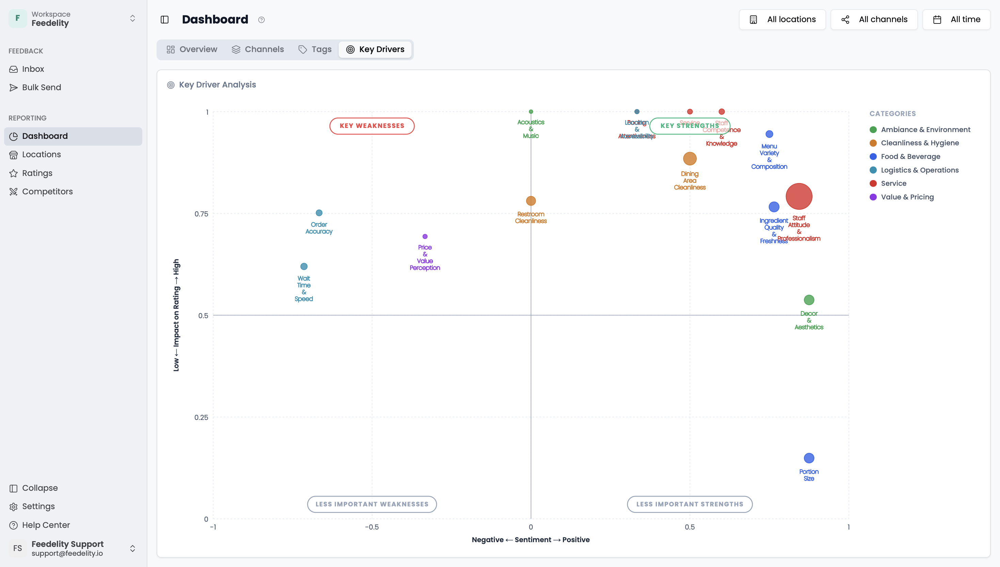
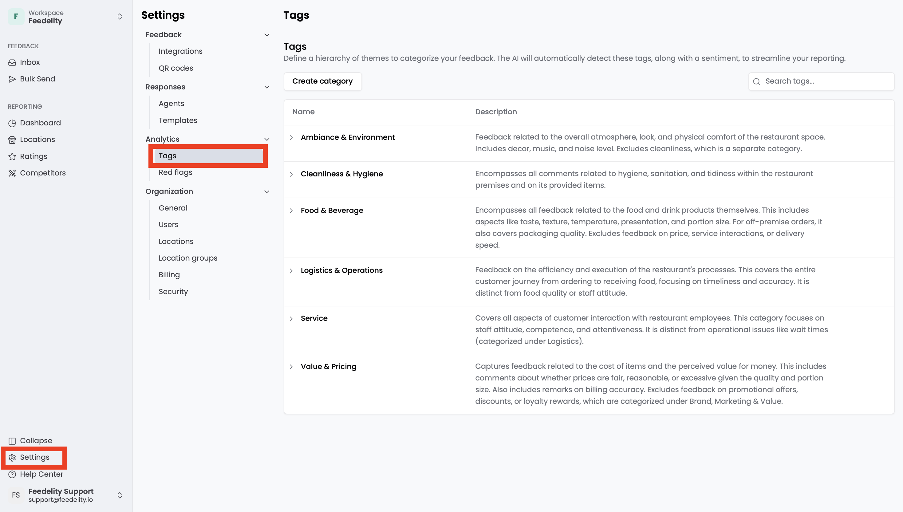

Tags automatically categorize your incoming customer feedback. Create and manage a set of relevant tags to track the topics that matter most to your business.

Feedelity automatically analyzes incoming feedback and labels it with the right tags and sentiment. You see categorized feedback in your [Inbox](/inbox/inbox) and aggregated data in your dashboards. For example, track mentions of "Hygiene" or "Staff Friendliness" to monitor performance in those areas.

Tags are assigned automatically, but you can always adjust the tags or sentiment of any case manually from the **Inbox**.

## Manage tags

Admins manage tags under **Settings** > **Tags**.

You can create tags at different levels. For example, create a tag category called "Food & Beverage" and add tags under it, such as "Temperature" or "Portion Size".

When you add a tag, you're asked for a description. The clearer and more detailed the description, the more accurately incoming guest feedback gets tagged.

- To view the tags and sub-tags in a category, click the category.
- To edit or delete a tag, hover over it and click the **Edit** (pencil) or **Delete** (trash can) icon.
