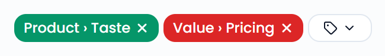
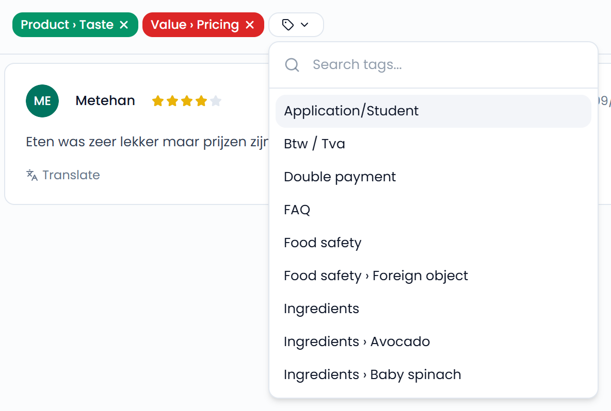
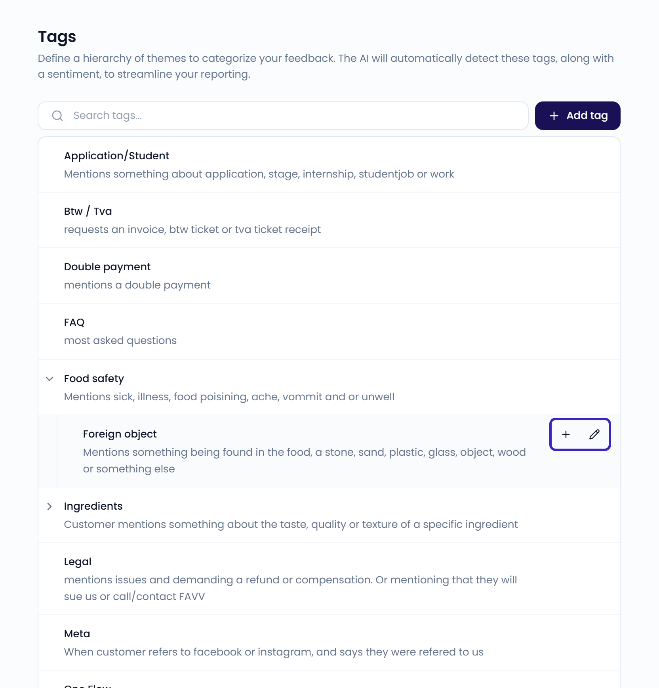

Tags categorize your incoming feedback by topic. Feedelity's AI detects your tags in each case, along with a sentiment. You see tagged feedback in your [inbox](/inbox/overview) and aggregated data in your dashboards.

For example, track mentions of "Hygiene" or "Staff friendliness" to monitor how your locations perform in those areas.

Tags are applied automatically, but you can always adjust the tags or sentiment of a case in the inbox. See [Tags, sentiment, and priority](/inbox/tags-sentiment-priority).

{/* SCREENSHOT: /inbox — an open case with its tags and sentiment */}
<Frame>
  
</Frame>

<Frame>
  
</Frame>

## Manage tags

Go to **Settings** > **Tags**, in the **Analytics** section.

<Note>
  Only administrators can access **Settings**.
</Note>

{/* SCREENSHOT: /settings/tags — the tag hierarchy with a category expanded and the hover actions visible */}
<Frame>
  
</Frame>

Tags form a hierarchy. For example, create a category called "Food & Beverage" and add sub-tags under it, such as "Temperature" or "Portion size".

- To create a category, click **Add tag**.
- To add a sub-tag, hover over a tag and click the **+** icon.
- To view the sub-tags in a category, click the category.
- To edit a tag, hover over it and click the pencil icon.

### Write a good description

Each tag has a **Name** and a **Description**. The name appears on cases, filters, and dashboards, so keep it short.

Feedelity uses the description to decide which feedback gets the tag. Say what the tag covers and what it doesn't. For example, for "Delivery time": "Feedback about how long orders take to arrive, including late or early deliveries. Doesn't cover delivery costs or driver behaviour."

### Delete a tag

Open the tag with the pencil icon, click **Delete**, and confirm.

<Warning>
  Deleting a tag also deletes its sub-tags and removes them from your past feedback. This can't be undone.
</Warning>
