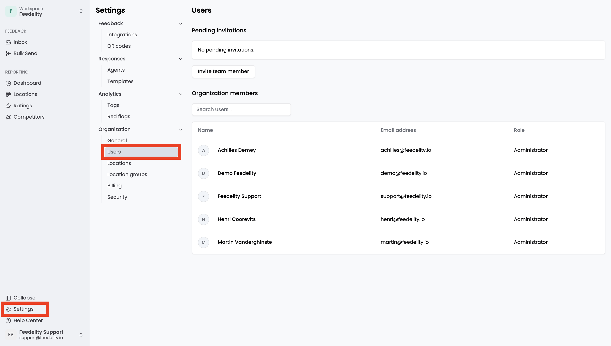
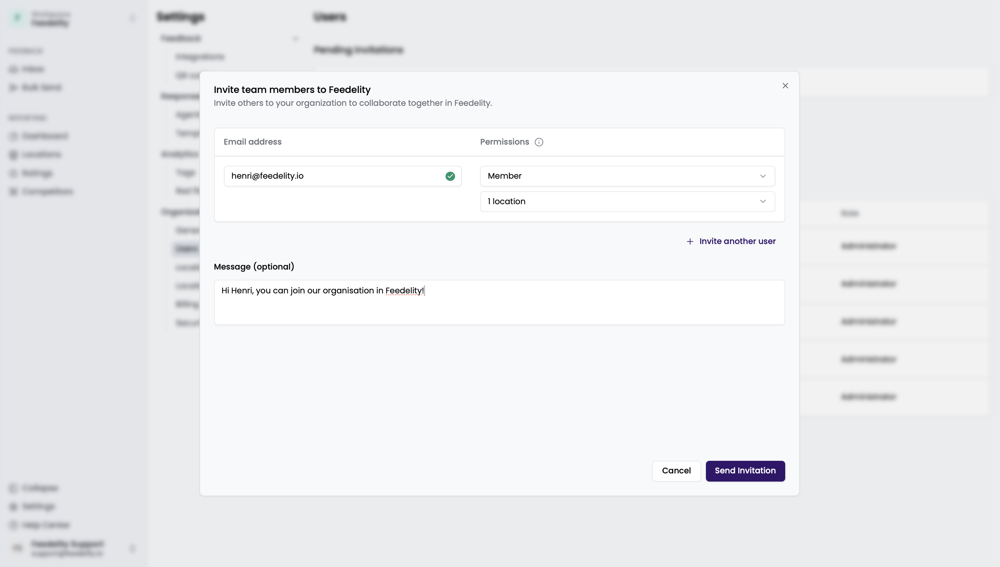
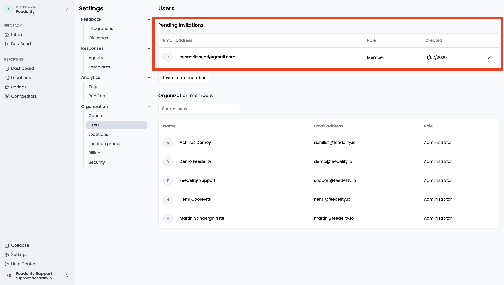
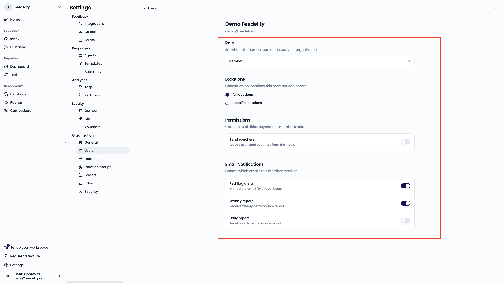

On the **Users** page, you add and remove users, manage roles, and configure notifications. This controls access and responsibilities within Feedelity. Go to **Settings** > **Users** to open it.

<Note>
  Only admins can see this page.
</Note>

## User roles

Feedelity has three user roles:

- **Admin**: Full access to all features and settings. Admins also manage user roles.
- **Member**: Can manage the inbox and bulk send, and view all dashboard pages. Members don't have access to **Settings**.
- **Viewer**: Has the same access as a member but can't perform actions, such as replying to or deleting a review. The only action a viewer can perform is tagging another user in the comment box of a case.

For members and viewers, admins can restrict access to specific locations. Users with assigned locations only see data from those locations in the inbox, bulk send, and dashboard.

| | Admin | Member | Viewer |
| --- | --- | --- | --- |
| View settings | ✅ | ❌ | ❌ |
| Modify settings: integrations, QR codes, response agents and templates, tags and flags, users, locations, location groups, billing, security | ✅ | ❌ | ❌ |
| View inbox | ✅ | ✅ For selected locations | ✅ For selected locations |
| Perform actions in inbox and bulk send | ✅ | ✅ For selected locations | ❌ Can only add case notes |
| View dashboard | ✅ | ✅ For selected locations | ✅ For selected locations |
| View locations page | ✅ | ✅ For all locations | ✅ For all locations |
| View ratings page | ✅ | ✅ For all locations | ✅ For all locations |
| Send credit vouchers | ✅ | ❌ Custom setting | ❌ |

## Invite users

To invite a user to your organization, click **Add user**. In the pop-up, enter the email address and permissions of the user you want to invite.

If you assign the member or viewer role, a second dropdown appears. Use it to grant access to specific locations. By default, all locations are selected.

The invited user receives an email with instructions to join the organization.

If someone creates a Feedelity account with one of your verified domains, they can request to join your organization. You manage verified domains under [Security](/settings/security). Admins see sent invitations and pending requests on the **Users** page.

## User settings

Click a user in your organization to update their role, location access, and other permissions. You can also:

- Set their notifications. Every user can set their own notification preferences by clicking their account name in the bottom-left corner.
- Remove the user from your organization.

Changes save automatically.

