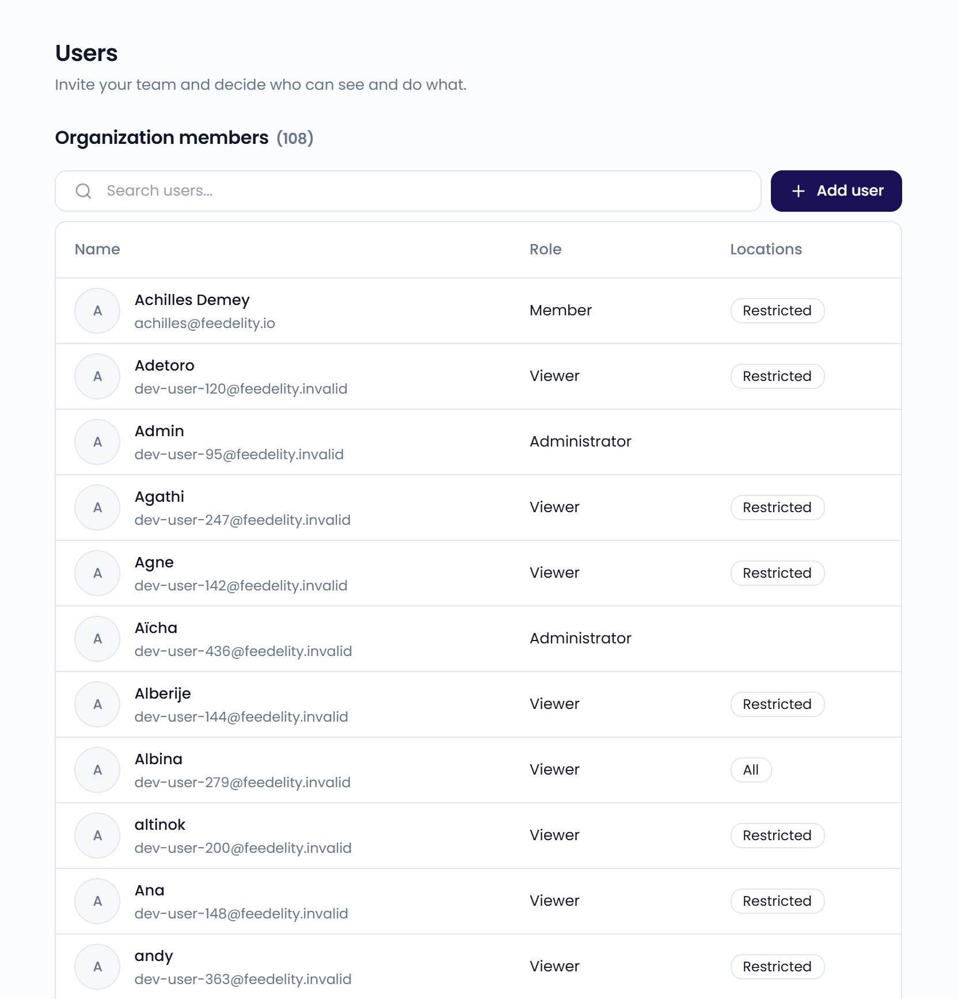
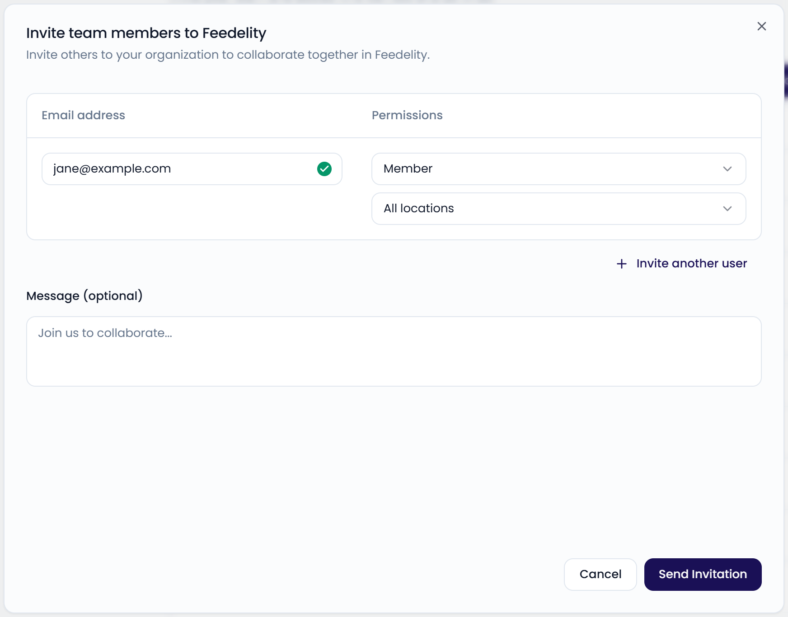
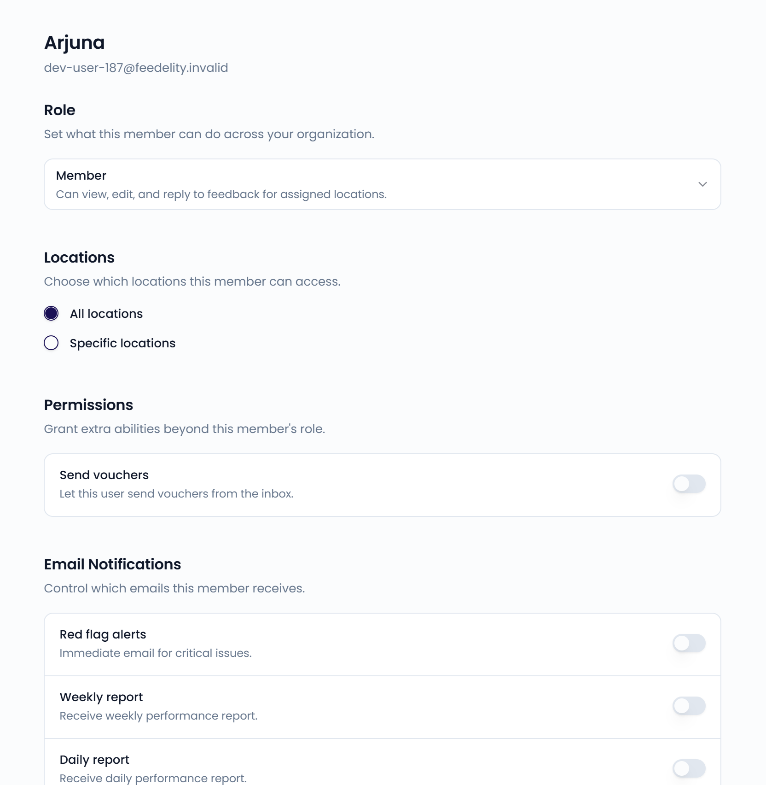

On the **Users** page, you invite your team and decide who can see and do what. Go to **Settings** > **Users**, in the **Organization** section, to open it. For how accounts, organizations, and roles fit together, see [How users and organizations work](/getting-started/users-and-organizations).

<Note>
  Only administrators can access **Settings**.
</Note>

{/* SCREENSHOT: /settings/users — Organization members list with Name, Role, and Locations columns */}
<Frame>
  
</Frame>

## User roles

Feedelity has three roles:

- **Administrator**: full access to all locations and settings. Can also invite users and send vouchers.
- **Member**: can view, edit, and reply to feedback for their assigned locations.
- **Viewer**: read-only access to feedback and reports for their assigned locations. Viewers can still add comments to a case.

| | Administrator | Member | Viewer |
| --- | --- | --- | --- |
| Open **Settings** and change any setting | ✅ | ❌ | ❌ |
| View the inbox and dashboards | ✅ All locations | ✅ Assigned locations | ✅ Assigned locations |
| Reply to, close, and tag cases | ✅ | ✅ Assigned locations | ❌ |
| Use bulk send | ✅ | ✅ Assigned locations | ❌ |
| Add comments to a case | ✅ | ✅ | ✅ |
| View benchmarks and ratings for all locations | ✅ | Only if **Show all locations in Benchmarks** is on | Only if **Show all locations in Benchmarks** is on |
| Send delivery platform credit with a reply | ✅ | Only with the **Send vouchers** permission | ❌ |

Bulk send and delivery platform credit are included in the trial and the Standard plan. On the Enterprise plan, they're add-ons. See [Billing and license](/settings/billing#features-per-plan).

## Invite users

<Steps>
  <Step title="Open the invite dialog">
    Click **Add user**.
  </Step>
  <Step title="Enter the email address and role">
    Enter the **Email address** and choose a role under **Permissions**. To invite several people at once, click **Invite another user**.
  </Step>
  <Step title="Choose location access">
    For members and viewers, choose which locations or location groups they can access. If you don't choose any, they get access to all locations.
  </Step>
  <Step title="Send the invitation">
    Optionally, add a message. Click **Send Invitation**.
  </Step>
</Steps>

{/* SCREENSHOT: /settings/users — the "Invite team members to Feedelity" dialog with email, role, and locations */}
<Frame>
  
</Frame>

The invited user receives an email with instructions to join your organization. Open invitations appear under **Pending invitations**.

### Join requests

If someone signs up with an email address from one of your [verified domains](/settings/security), they can request to join your organization. Their request appears under **Pending requests**.

- Click **Approve**, choose a **Role** and **Location access**, and click **Approve request**.
- Click **Reject** and confirm with **Reject request**. The person gets an email that the request was rejected.

{/* SCREENSHOT: /settings/users — Pending invitations and Pending requests sections */}

## Manage a user

Click a user to open their settings. Changes save automatically.

- **Role**: change what the user can do. You can't change your own role.
- **Locations**: for members and viewers, choose **All locations** or **Specific locations**. With specific locations, you can select individual locations and location groups.
- **Permissions**: for members and viewers, grant extra abilities beyond their role. Turn on **Send vouchers** to let the user add delivery platform credit to replies. See [Add credit to a reply](/inbox/credit).
- **Email Notifications**: choose which emails the user receives: **Red flag alerts**, **Weekly report**, and **Daily report**.

Users can also change their own email notifications in their [profile](/profile/notifications).

To remove a user from your organization, click **Remove user** and confirm. This can't be undone.

{/* SCREENSHOT: /settings/users/<id> — user page with Role, Locations, Permissions, and Email Notifications */}
<Frame>
  
</Frame>

### Location access

When you give a user access to a location group, they get access to every location in that group. If you add a location to the group later, the user gets access to it too.

## Advanced settings

At the bottom of the **Users** page, **Show all locations in Benchmarks** lets every user view benchmark statistics for all locations on the **Locations** and **Ratings** pages. When it's off, users only see benchmark data for their assigned locations.
